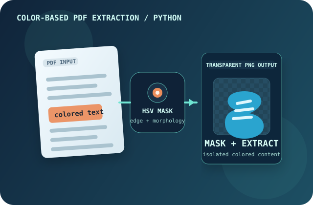
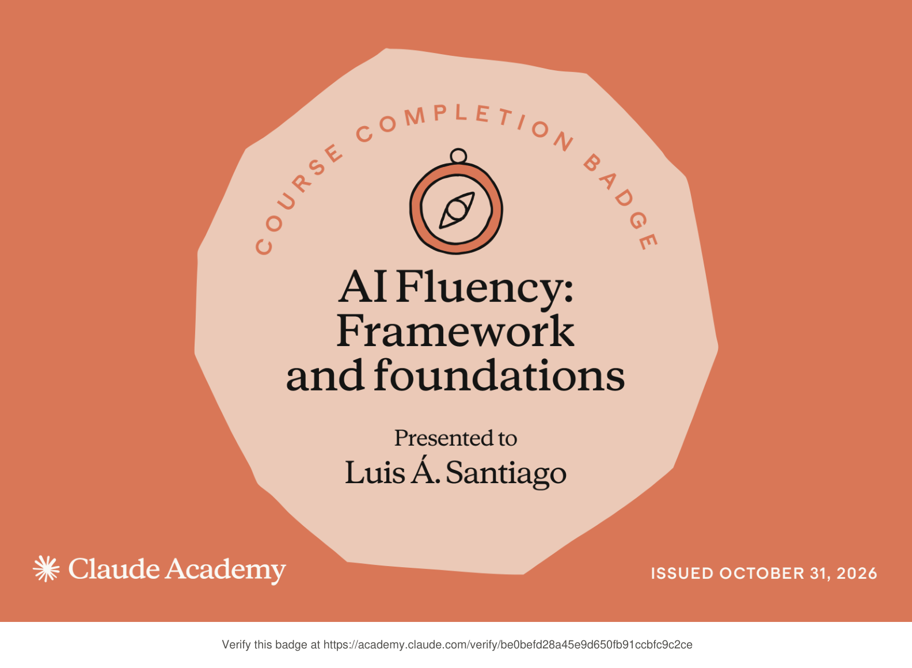
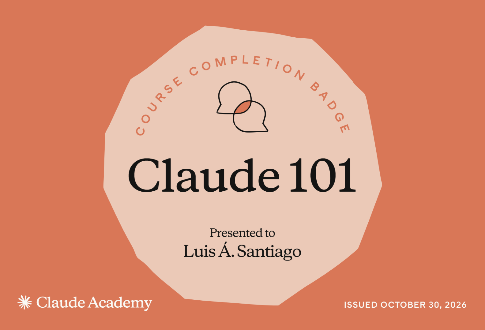

# Implemented portfolio changes

All source edits are included below as unified diffs. Unchanged assets are retained.

## FILE: index.html

```diff
--- old/index.html
+++ new/index.html
@@ -2,10 +2,21 @@
 <html lang="en">
 <head>
   <meta charset="utf-8">
+  <meta http-equiv="Content-Security-Policy" content="default-src 'self'; script-src 'self' 'sha256-8lj084j7BK4k48MfS7d0+6xiMqTZX0E+jgQ/S84ZmN0='; style-src 'self'; img-src 'self'; font-src 'self'; connect-src 'none'; object-src 'none'; base-uri 'self'; form-action 'none'">
   <meta name="viewport" content="width=device-width, initial-scale=1">
   <meta name="theme-color" content="#091222">
   <meta name="description" content="Portfolio of Luis Santiago, computer engineering student at UAGM. Projects, research, experience, community involvement, and verified credentials.">
   <title>Luis Santiago — Computer Engineering Portfolio</title>
+  <link rel="canonical" href="https://nulask.github.io/">
+  <meta property="og:type" content="website">
+  <meta property="og:site_name" content="Luis Santiago Portfolio">
+  <meta property="og:title" content="Luis Santiago — Computer Engineering Portfolio">
+  <meta property="og:description" content="Computer engineering projects, undergraduate research, engineering experience, and verified credentials.">
+  <meta property="og:url" content="https://nulask.github.io/">
+  <meta name="twitter:card" content="summary">
+  <meta name="twitter:title" content="Luis Santiago — Computer Engineering Portfolio">
+  <meta name="twitter:description" content="Computer engineering projects, undergraduate research, and engineering experience.">
+  <script type="application/ld+json">{"@context":"https://schema.org","@type":"Person","name":"Luis Santiago","url":"https://nulask.github.io/","description":"Computer Engineering student at Universidad Ana G. Méndez.","affiliation":{"@type":"CollegeOrUniversity","name":"Universidad Ana G. Méndez"}}</script>
   <link rel="stylesheet" href="styles.css">
 </head>
 <body>
@@ -17,10 +28,19 @@
       <div class="nav-links" id="nav-links"><a href="#about">About</a><a href="#projects">Projects</a><a href="#experience">Experience</a><a href="#community">Community</a><a href="#credentials">Credentials</a><a class="nav-contact" href="#contact">Let's connect <span aria-hidden="true">↗</span></a></div>
     </nav>
   </header>
-  <main id="main">
+  <main id="main" tabindex="-1">
     <section class="hero wrap" id="home">
-      <div class="hero-copy"><p class="eyebrow"><span class="status-dot"></span> Computer engineering · Puerto Rico</p><h1>Engineering with <em>curiosity.</em><br>Building with <em>purpose.</em></h1><p class="hero-lede">I'm <strong>Luis Santiago</strong>, a Computer Engineering student at Universidad Ana G. Méndez. I connect software, applied research, and technical problem-solving to build things that matter.</p><div class="actions"><a class="btn primary" href="#projects">Explore my work <span aria-hidden="true">↗</span></a><a class="btn secondary" href="#contact">Get in touch <span aria-hidden="true">→</span></a></div><div class="hero-facts"><div><strong>2028</strong><span>Expected graduation</span></div><div><strong>3.77</strong><span>GPA / 4.00</span></div><div><strong>PR</strong><span>Based in Puerto Rico</span></div></div></div>
-      <div class="hero-visual" aria-label="Illustration combining software development, engineering, and research"><div class="orb orb-one"></div><div class="orb orb-two"></div><div class="code-window"><div class="window-top"><span class="dots"><i></i><i></i><i></i></span><span>luis.santiago / portfolio</span><span>↗</span></div><pre><span class="cm">// Engineer · Researcher · Builder</span>
+      <div class="hero-copy"><p class="eyebrow"><span class="status-dot"></span> Computer engineering · Puerto Rico</p><h1>Engineering with <em>curiosity.</em><br>Building with <em>purpose.</em></h1><p class="hero-lede">I'm <strong>Luis Santiago</strong>, a Computer Engineering student at Universidad Ana G. Méndez. I connect software, applied research, and technical problem-solving to build things that matter.</p>
+<div class="actions"><a class="btn primary" href="#projects">Explore my work <span aria-hidden="true">↗</span></a><a class="btn secondary" href="#contact">Get in touch <span aria-hidden="true">→</span></a></div>
+<div class="hero-facts">
+<div><strong>2028</strong><span>Expected graduation</span></div>
+<div><strong>3.77</strong><span>GPA / 4.00</span></div>
+<div><strong>PR</strong><span>Based in Puerto Rico</span></div></div></div>
+      <div class="hero-visual" aria-hidden="true">
+<div class="orb orb-one"></div>
+<div class="orb orb-two"></div>
+<div class="code-window">
+<div class="window-top"><span class="dots"><i></i><i></i><i></i></span><span>luis.santiago / portfolio</span><span>↗</span></div><pre><span class="cm">// Engineer · Researcher · Builder</span>
 <span class="kw">const</span> curiosity = <span class="str">"always on"</span>;
 
 <span class="kw">const</span> focus = [
@@ -29,20 +49,124 @@
   <span class="str">"real-world impact"</span>
 ];
 
-<span class="fn">build</span>(ideas, curiosity); <span class="cursor">▌</span></pre><div class="window-bottom"><span>● ALL SYSTEMS CURIOUS</span><span>COMP. ENG.</span></div></div><div class="floating-tag tag-top">&lt;/&gt; Development</div><div class="floating-tag tag-bottom">✦ Interdisciplinary research</div></div>
+<span class="fn">build</span>(ideas, curiosity); <span class="cursor">▌</span></pre>
+<div class="window-bottom"><span>● ALL SYSTEMS CURIOUS</span><span>COMP. ENG.</span></div></div>
+<div class="floating-tag tag-top">&lt;/&gt; Development</div>
+<div class="floating-tag tag-bottom">✦ Interdisciplinary research</div></div>
     </section>
-    <section class="section border-top" id="about"><div class="wrap about-grid"><div><p class="eyebrow">01 / About me</p><h2>At the intersection of <span class="accent">code, science, and engineering.</span></h2></div><div class="about-body"><p>I'm pursuing a B.S. in Computer Engineering at UAGM in Gurabo, Puerto Rico. My interests span programming, problem-solving, research, and practical engineering applications.</p><p>From designing scheduling algorithms in C++ to interpreting microscopy imagery for nanomaterials research, I enjoy learning across disciplines and translating complicated concepts into usable solutions.</p><div class="skills"><span>C++</span><span>Java</span><span>MATLAB</span><span>SQL</span><span>Excel / VBA</span><span>Research</span><span>Technical analysis</span></div></div></div></section>
-    <section class="section dark-section" id="projects"><div class="wrap"><div class="section-heading"><div><p class="eyebrow">02 / Selected projects</p><h2>Projects & <span class="accent">problem-solving.</span></h2></div><p>Academic and independent work exploring algorithms, numerical computing, image processing, and useful tools.</p></div><div class="project-grid"><article class="project-card featured"><div class="project-art art-schedule" aria-hidden="true"><div class="graph-label">PROCESS SCHEDULING / C++</div><div class="gantt"><i></i><i></i><i></i><i></i><i></i><i></i><i></i></div><div class="graph-lines"></div></div><div class="project-content"><div class="meta">01 <span>Algorithms · C++</span></div><h3>CPU Scheduling Simulator</h3><p>Built five scheduling modes—including round robin, FCFS, shortest-job-first, priority, and multilevel feedback queue—using custom linked-list data structures. Produces Gantt charts and process-level timing metrics.</p><div class="tags"><span>C++</span><span>Data structures</span><span>Scheduling</span></div></div></article><article class="project-card"><div class="project-art art-svd" aria-hidden="true"><div class="matrix matrix-one">1 0 0<br>0 1 0<br>0 0 1</div><div class="svd-symbol">≈</div><div class="matrix matrix-two">Σ σ₁ σ₂<br>U × Vᵀ<br>rank k</div></div><div class="project-content"><div class="meta">02 <span>Numerical computing · MATLAB</span></div><h3>Image Analysis with SVD</h3><p>Compared grayscale and RGB image reconstructions across SVD ranks using visual quality, storage estimates, singular-value decay, and relative Frobenius error. Implemented a search for approximations below 10% relative error.</p><div class="tags"><span>MATLAB</span><span>Linear algebra</span><span>Image analysis</span></div></div></article><article class="project-card"><div class="project-art art-road" aria-hidden="true"><div class="road"><div class="lane"></div><div class="lane"></div><div class="lane"></div></div><span>SMARTER INFRASTRUCTURE</span></div><div class="project-content"><div class="meta">03 <span>Innovation · Team project</span></div><h3>Innovación Vial Inteligente</h3><p>Worked on an intelligent road innovation concept during the High School Energy Summer Camp. The team placed first in the June 2023 ENGITHLON competition.</p><div class="tags"><span>Engineering design</span><span>Teamwork</span><span>1st place</span></div></div></article><article class="project-card"><div class="project-art art-extraction" aria-hidden="true"><picture><source media="(max-width: 650px)" srcset="assets/project-color-extraction-mobile.svg"></picture></div><div class="project-content"><div class="meta">04 <span>Computer vision · Python</span></div><h3>Color-Based PDF Content Extraction</h3><p>Created a Python script that renders a PDF page at 300 DPI, selects color-specific regions in HSV space, and combines color masking, edge detection, and morphological filtering to isolate colored content. Exports a mask, an extracted image, and a transparent PNG.</p><div class="tags"><span>Python</span><span>OpenCV</span><span>NumPy</span><span>PyMuPDF</span></div></div></article></div></div></section>
-    <section class="section" id="experience"><div class="wrap"><div class="section-heading"><div><p class="eyebrow">03 / Experience & research</p><h2>Learning through <span class="accent">real work.</span></h2></div><p>Technical work across engineering assessments and experimental research.</p></div><div class="timeline"><article class="timeline-item"><div class="timeline-date">Mar 2026 — Present</div><div class="timeline-node"></div><div><p class="eyebrow small">Engineering experience</p><h3>Energy Auditor Trainee <span>· MIIAC Program, UAGM</span></h3><p>Trained in ASHRAE Level II assessment procedures and supported compressed-air leak assessments at Nelipak and lighting/HVAC assessments at Banco de Desarrollo de Puerto Rico. Used Excel and AirMaster+ in energy savings analyses and technical recommendations.</p><div class="tags"><span>Energy audits</span><span>HVAC</span><span>AirMaster+</span><span>Excel</span></div></div></article><article class="timeline-item"><div class="timeline-date">Jan — May 2025</div><div class="timeline-node"></div><div><p class="eyebrow small">Undergraduate research</p><h3>Research Fellow <span>· NSF PR-LSAMP, UAGM</span></h3><p>Investigated ZnO-based photocatalysts for hydrogen production and ciprofloxacin degradation. Conducted experimental work and analyzed HRTEM/HRSEM imagery to interpret material characteristics. Presented findings at PRISM and the ACS Junior Technical Meeting.</p><div class="tags"><span>Nanomaterials</span><span>Photocatalysis</span><span>Microscopy analysis</span></div></div></article></div></div></section>
-    <section class="section community-section" id="community"><div class="wrap"><div class="section-heading"><div><p class="eyebrow">04 / Beyond the classroom</p><h2>Community & <span class="accent">leadership.</span></h2></div><p>Collaboration, outreach, and sharing enthusiasm for STEM.</p></div><div class="community-grid"><article class="simple-card"><div class="card-icon">✳</div><h3>ACS Student Chapter</h3><p>Served on the UAGM chapter's board (Aug 2025–Aug 2026), supporting event planning, weekly meeting documentation, promotional materials, and member engagement.</p><div class="card-footer">Leadership & organization</div></article><article class="simple-card"><div class="card-icon">⌁</div><h3>Science outreach</h3><p>Participated in National Chemistry Week and the ACS Chemistry Festival to help connect communities with the chemical sciences.</p><div class="card-footer">Volunteering & STEM education</div></article><article class="simple-card"><div class="card-icon">✧</div><h3>Honors & campus involvement</h3><p>Engaged with UAGM's Honors Program and campus activities, bringing together learning, community, and interdisciplinary interests.</p><div class="card-footer">Academic community</div></article></div></div></section>
-    <section class="section" id="credentials"><div class="wrap"><div class="section-heading"><div><p class="eyebrow">05 / Credentials & recognition</p><h2>Committed to <span class="accent">continuous learning.</span></h2></div><p>Course completions and academic recognition, with direct verification links.</p></div><div class="credential-grid">
-<article class="credential-card badge-card"><a class="badge-image-link" href="https://academy.claude.com/verify/be0befd28a45e9d650fb91ccbfc9c2ce" target="_blank" rel="noopener noreferrer" aria-label="Verify AI Fluency: Framework and Foundations credential"></a><div class="credential-top"><span class="credential-provider">Claude Academy · Anthropic</span><span class="verified">Oct 31, 2026</span></div><h3>AI Fluency: Framework and Foundations</h3><p>Course completion badge covering foundational AI fluency concepts and frameworks.</p><a href="https://academy.claude.com/verify/be0befd28a45e9d650fb91ccbfc9c2ce" target="_blank" rel="noopener noreferrer">Verify credential <span aria-hidden="true">↗</span></a><a class="credential-sub-link" href="assets/claude-ai-fluency.pdf" target="_blank" rel="noopener noreferrer">Open certificate PDF <span aria-hidden="true">↗</span></a></article>
-<article class="credential-card badge-card"><a class="badge-image-link" href="https://academy.claude.com/verify/e2fab86d98a7895273e68610ebca3dd0" target="_blank" rel="noopener noreferrer" aria-label="Verify Claude 101 credential"></a><div class="credential-top"><span class="credential-provider">Claude Academy · Anthropic</span><span class="verified">Oct 30, 2026</span></div><h3>Claude 101</h3><p>Introductory Claude Academy course completion badge.</p><a href="https://academy.claude.com/verify/e2fab86d98a7895273e68610ebca3dd0" target="_blank" rel="noopener noreferrer">Verify credential <span aria-hidden="true">↗</span></a><a class="credential-sub-link" href="assets/claude-101.pdf" target="_blank" rel="noopener noreferrer">Open certificate PDF <span aria-hidden="true">↗</span></a></article>
-<article class="credential-card"><div class="credential-top"><div class="credential-symbol matlab">∑</div><span class="verified">Certificate ↗</span></div><p class="credential-provider">MathWorks</p><h3>MATLAB Onramp</h3><p>Foundational training in MATLAB programming, data operations, and technical computing.</p><a href="https://matlabacademy.mathworks.com/progress/share/certificate.html?id=cc80fef1-a153-4070-8963-bc6e33bc3fb5" target="_blank" rel="noopener noreferrer">View certificate <span aria-hidden="true">↗</span></a></article>
-<article class="credential-card award"><div class="credential-top"><div class="credential-symbol trophy">★</div><span class="verified">June 2023</span></div><p class="credential-provider">ENGITHLON · High School Energy Summer Camp</p><h3>First Place — ENGITHLON</h3><p>Team award for <em>Innovación Vial Inteligente</em>, an intelligent road innovation project.</p></article></div></div></section>
-    <section class="contact-section" id="contact"><div class="wrap contact-grid"><div><p class="eyebrow">06 / Let's connect</p><h2>Have something <span class="accent">in mind?</span></h2><p>I'm interested in internships, technical collaborations, and opportunities to keep learning across software and engineering.</p></div><div class="contact-actions"><a class="btn primary" href="mailto:lask12172006@outlook.com">Email me <span aria-hidden="true">↗</span></a><span>lask12172006@outlook.com</span></div></div></section>
+    <section class="section border-top" id="about">
+<div class="wrap about-grid">
+<div><p class="eyebrow">01 / About me</p><h2>At the intersection of <span class="accent">code, science, and engineering.</span></h2></div>
+<div class="about-body"><p>I'm pursuing a B.S. in Computer Engineering at UAGM in Gurabo, Puerto Rico. My interests span programming, problem-solving, research, and practical engineering applications.</p><p>From designing scheduling algorithms in C++ to interpreting microscopy imagery for nanomaterials research, I enjoy learning across disciplines and translating complicated concepts into usable solutions.</p>
+<div class="skills"><span>C++</span><span>Java</span><span>MATLAB</span><span>SQL</span><span>Excel / VBA</span><span>Research</span><span>Technical analysis</span></div></div></div>
+</section>
+    <section class="section dark-section" id="projects">
+<div class="wrap">
+<div class="section-heading">
+<div><p class="eyebrow">02 / Selected projects</p><h2>Projects & <span class="accent">problem-solving.</span></h2></div><p>Academic and independent work exploring algorithms, numerical computing, image processing, and useful tools.</p></div>
+<div class="project-grid">
+<article class="project-card featured">
+<div class="project-art art-schedule" aria-hidden="true">
+<div class="graph-label">PROCESS SCHEDULING / C++</div>
+<div class="gantt"><i></i><i></i><i></i><i></i><i></i><i></i><i></i></div>
+<div class="graph-lines"></div></div>
+<div class="project-content">
+<div class="meta">01 <span>Algorithms · C++</span></div><h3>CPU Scheduling Simulator</h3><p>Built five scheduling modes—including round robin, FCFS, shortest-job-first, priority, and multilevel feedback queue—using custom linked-list data structures. Produces Gantt charts and process-level timing metrics.</p>
+<div class="tags"><span>C++</span><span>Data structures</span><span>Scheduling</span></div></div>
+</article>
+<article class="project-card">
+<div class="project-art art-svd" aria-hidden="true">
+<div class="matrix matrix-one">1 0 0<br>0 1 0<br>0 0 1</div>
+<div class="svd-symbol">≈</div>
+<div class="matrix matrix-two">Σ σ₁ σ₂<br>U × Vᵀ<br>rank k</div></div>
+<div class="project-content">
+<div class="meta">02 <span>Numerical computing · MATLAB</span></div><h3>Image Analysis with SVD</h3><p>Compared grayscale and RGB image reconstructions across SVD ranks using visual quality, storage estimates, singular-value decay, and relative Frobenius error. Implemented a search for approximations below 10% relative error.</p>
+<div class="tags"><span>MATLAB</span><span>Linear algebra</span><span>Image analysis</span></div></div>
+</article>
+<article class="project-card">
+<div class="project-art art-road" aria-hidden="true">
+<div class="road">
+<div class="lane"></div>
+<div class="lane"></div>
+<div class="lane"></div></div><span>SMARTER INFRASTRUCTURE</span></div>
+<div class="project-content">
+<div class="meta">03 <span>Innovation · Team project</span></div><h3 lang="es">Innovación Vial Inteligente</h3><p>Worked on an intelligent road innovation concept during the High School Energy Summer Camp. The team placed first in the June 2023 ENGITHLON competition.</p>
+<div class="tags"><span>Engineering design</span><span>Teamwork</span><span>1st place</span></div></div>
+</article>
+<article class="project-card">
+<div class="project-art art-extraction" aria-hidden="true">
+<picture><source media="(max-width: 650px)" srcset="assets/project-color-extraction-mobile.svg" width="640" height="350">
+</picture></div>
+<div class="project-content">
+<div class="meta">04 <span>Computer vision · Python</span></div><h3>Color-Based PDF Content Extraction</h3><p>Created a Python script that renders a PDF page at 300 DPI, selects color-specific regions in HSV space, and combines color masking, edge detection, and morphological filtering to isolate colored content. Exports a mask, an extracted image, and a transparent PNG.</p>
+<div class="tags"><span>Python</span><span>OpenCV</span><span>NumPy</span><span>PyMuPDF</span></div></div>
+</article></div></div>
+</section>
+    <section class="section" id="experience">
+<div class="wrap">
+<div class="section-heading">
+<div><p class="eyebrow">03 / Experience & research</p><h2>Learning through <span class="accent">real work.</span></h2></div><p>Technical work across engineering assessments and experimental research.</p></div>
+<div class="timeline">
+<article class="timeline-item">
+<div class="timeline-date">Mar 2026 — Present</div>
+<div class="timeline-node"></div>
+<div><p class="eyebrow small">Engineering experience</p><h3>Energy Auditor Trainee <span>· MIIAC Program, UAGM</span></h3><p>Trained in ASHRAE Level II assessment procedures and supported compressed-air leak assessments at Nelipak and lighting/HVAC assessments at Banco de Desarrollo de Puerto Rico. Used Excel and AirMaster+ in energy savings analyses and technical recommendations.</p>
+<div class="tags"><span>Energy audits</span><span>HVAC</span><span>AirMaster+</span><span>Excel</span></div></div>
+</article>
+<article class="timeline-item">
+<div class="timeline-date">Jan — May 2025</div>
+<div class="timeline-node"></div>
+<div><p class="eyebrow small">Undergraduate research</p><h3>Research Fellow <span>· NSF PR-LSAMP, UAGM</span></h3><p>Investigated ZnO-based photocatalysts for hydrogen production and ciprofloxacin degradation. Conducted experimental work and analyzed HRTEM/HRSEM imagery to interpret material characteristics. Presented findings at PRISM and the ACS Junior Technical Meeting.</p>
+<div class="tags"><span>Nanomaterials</span><span>Photocatalysis</span><span>Microscopy analysis</span></div></div>
+</article></div></div>
+</section>
+    <section class="section community-section" id="community">
+<div class="wrap">
+<div class="section-heading">
+<div><p class="eyebrow">04 / Beyond the classroom</p><h2>Community & <span class="accent">leadership.</span></h2></div><p>Collaboration, outreach, and sharing enthusiasm for STEM.</p></div>
+<div class="community-grid">
+<article class="simple-card">
+<div class="card-icon">✳</div><h3>ACS Student Chapter</h3><p>Served on the UAGM chapter's board (Aug 2025–Aug 2026), supporting event planning, weekly meeting documentation, promotional materials, and member engagement.</p>
+<div class="card-footer">Leadership & organization</div>
+</article>
+<article class="simple-card">
+<div class="card-icon">⌁</div><h3>Science outreach</h3><p>Participated in National Chemistry Week and the ACS Chemistry Festival to help connect communities with the chemical sciences.</p>
+<div class="card-footer">Volunteering & STEM education</div>
+</article>
+<article class="simple-card">
+<div class="card-icon">✧</div><h3>Honors & campus involvement</h3><p>Engaged with UAGM's Honors Program and campus activities, bringing together learning, community, and interdisciplinary interests.</p>
+<div class="card-footer">Academic community</div>
+</article></div></div>
+</section>
+    <section class="section" id="credentials">
+<div class="wrap">
+<div class="section-heading">
+<div><p class="eyebrow">05 / Credentials & recognition</p><h2>Committed to <span class="accent">continuous learning.</span></h2></div><p>Course completions and academic recognition, with direct verification links.</p></div>
+<div class="credential-grid">
+<article class="credential-card badge-card"><a class="badge-image-link" href="https://academy.claude.com/verify/be0befd28a45e9d650fb91ccbfc9c2ce" target="_blank" rel="noopener noreferrer" aria-label="Verify AI Fluency: Framework and Foundations credential"></a>
+<div class="credential-top"><span class="credential-provider">Claude Academy · Anthropic</span><span class="verified">Oct 31, 2026</span></div><h3>AI Fluency: Framework and Foundations</h3><p>Course completion badge covering foundational AI fluency concepts and frameworks.</p><a class="credential-verify" href="https://academy.claude.com/verify/be0befd28a45e9d650fb91ccbfc9c2ce" target="_blank" rel="noopener noreferrer">Verify credential <span aria-hidden="true">↗</span></a><a class="credential-sub-link" href="assets/claude-ai-fluency.pdf" target="_blank" rel="noopener noreferrer">Open certificate PDF <span aria-hidden="true">↗</span></a>
+</article>
+<article class="credential-card badge-card"><a class="badge-image-link" href="https://academy.claude.com/verify/e2fab86d98a7895273e68610ebca3dd0" target="_blank" rel="noopener noreferrer" aria-label="Verify Claude 101 credential"></a>
+<div class="credential-top"><span class="credential-provider">Claude Academy · Anthropic</span><span class="verified">Oct 30, 2026</span></div><h3>Claude 101</h3><p>Introductory Claude Academy course completion badge.</p><a class="credential-verify" href="https://academy.claude.com/verify/e2fab86d98a7895273e68610ebca3dd0" target="_blank" rel="noopener noreferrer">Verify credential <span aria-hidden="true">↗</span></a><a class="credential-sub-link" href="assets/claude-101.pdf" target="_blank" rel="noopener noreferrer">Open certificate PDF <span aria-hidden="true">↗</span></a>
+</article>
+<article class="credential-card">
+<div class="credential-top">
+<div class="credential-symbol matlab">∑</div><span class="verified">Certificate ↗</span></div><p class="credential-provider">MathWorks</p><h3>MATLAB Onramp</h3><p>Foundational training in MATLAB programming, data operations, and technical computing.</p><a href="https://matlabacademy.mathworks.com/progress/share/certificate.html?id=cc80fef1-a153-4070-8963-bc6e33bc3fb5" target="_blank" rel="noopener noreferrer">View certificate <span aria-hidden="true">↗</span></a>
+</article>
+<article class="credential-card award">
+<div class="credential-top">
+<div class="credential-symbol trophy">★</div><span class="verified">June 2023</span></div><p class="credential-provider">ENGITHLON · High School Energy Summer Camp</p><h3>First Place — ENGITHLON</h3><p>Team award for <em lang="es">Innovación Vial Inteligente</em>, an intelligent road innovation project.</p>
+</article></div></div>
+</section>
+    <section class="contact-section" id="contact">
+<div class="wrap contact-grid">
+<div><p class="eyebrow">06 / Let's connect</p><h2>Have something <span class="accent">in mind?</span></h2><p>I'm interested in internships, technical collaborations, and opportunities to keep learning across software and engineering.</p></div>
+<div class="contact-actions"><a class="btn primary" href="mailto:lask12172006@outlook.com">Email me <span aria-hidden="true">↗</span></a><span>lask12172006@outlook.com</span></div></div>
+</section>
   </main>
-  <footer class="footer"><div class="wrap footer-inner"><a class="logo-mark" href="#home">LS<span class="accent">.</span></a><p>Designed & built with purpose · © <span id="year">2026</span> Luis Santiago</p><a href="#home">Back to top ↑</a></div></footer>
+  <footer class="footer">
+<div class="wrap footer-inner"><a class="logo-mark" href="#home">LS<span class="accent">.</span></a><p>Designed & built with purpose · © <span id="year">2026</span> Luis Santiago</p><a href="#home">Back to top ↑</a></div>
+</footer>
   <script src="script.js" defer></script>
 </body>
 </html>

```

## FILE: styles.css

```diff
--- old/styles.css
+++ new/styles.css
@@ -1,25 +1,1035 @@
-:root{color-scheme:dark;--bg:#091222;--bg2:#0e1b30;--panel:#12243b;--stroke:#26384c;--text:#eef4f7;--muted:#a4b4c4;--accent:#68e1d0;--accent2:#98c6ff;--font:Inter,ui-sans-serif,system-ui,-apple-system,BlinkMacSystemFont,'Segoe UI',sans-serif}*{box-sizing:border-box}html{scroll-behavior:smooth;scroll-padding-top:76px}body{margin:0;background:var(--bg);color:var(--text);font:16px/1.7 var(--font)}a{color:inherit;text-decoration:none}a:focus-visible,button:focus-visible{outline:3px solid var(--accent);outline-offset:4px}button{font:inherit}.wrap{width:min(1160px,calc(100% - 56px));margin:auto}.skip-link{position:absolute;z-index:30;top:-100px;left:12px;background:white;color:#091222;padding:8px}.skip-link:focus{top:12px}.accent{color:var(--accent)}.site-header{position:sticky;top:0;z-index:10;border-bottom:1px solid rgba(163,201,224,.11);backdrop-filter:blur(24px);background:rgba(9,18,34,.9)}.nav{height:76px;display:flex;align-items:center;justify-content:space-between;gap:20px}.logo{display:flex;gap:14px;align-items:center}.logo-mark{font-size:26px;font-weight:850;letter-spacing:-1px}.logo-caption{font-size:10px;letter-spacing:2.6px;color:var(--muted);padding-left:14px;border-left:1px solid var(--stroke)}.nav-links{display:flex;align-items:center;gap:25px;font-size:12px;font-weight:650;color:#b9c8d6}.nav-links a:hover,.footer a:hover{color:var(--accent)}.nav-links .nav-contact{color:var(--accent);border:1px solid #2f817e;padding:9px 13px;border-radius:7px}.menu-toggle{display:none;border:1px solid var(--stroke);background:var(--panel);color:var(--text);border-radius:6px;padding:5px 12px}.hero{display:grid;grid-template-columns:1.07fr .93fr;min-height:690px;align-items:center;gap:40px;padding-block:90px 80px}.eyebrow{text-transform:uppercase;letter-spacing:2.4px;color:var(--accent);font-weight:750;font-size:11px;margin:0 0 22px}.status-dot{display:inline-block;width:7px;height:7px;border-radius:100%;background:var(--accent);box-shadow:0 0 0 5px #68e1d022;margin-right:11px}.hero h1,h2,h3,p{margin-top:0}.hero h1{font-size:clamp(42px,5.35vw,74px);letter-spacing:-3.8px;line-height:1.13;margin-bottom:24px;font-weight:830}.hero h1 em{font-style:normal;color:var(--accent)}.hero-lede{font-size:17px;max-width:565px;line-height:1.9;color:var(--muted)}.hero-lede strong{color:white}.actions{display:flex;gap:12px;margin:31px 0 47px;flex-wrap:wrap}.btn{display:inline-flex;align-items:center;justify-content:space-between;gap:24px;min-height:47px;border-radius:7px;padding:11px 18px;font-size:13px;font-weight:750;transition:transform .2s}.btn:hover{transform:translateY(-3px)}.btn.primary{background:var(--accent);color:#07192a}.btn.secondary{border:1px solid #3d5368;color:var(--text)}.hero-facts{display:flex;gap:40px;border-top:1px solid var(--stroke);padding-top:23px}.hero-facts div{display:flex;flex-direction:column}.hero-facts strong{font-size:23px;line-height:1.3}.hero-facts span{font-size:11px;color:var(--muted)}.hero-visual{position:relative;min-height:430px;display:grid;place-items:center}.orb{position:absolute;border-radius:50%;filter:blur(2px)}.orb-one{width:350px;height:350px;border:1px solid #256e79;box-shadow:0 0 120px #145c7350;background:radial-gradient(circle,#1f56725b,transparent 65%)}.orb-two{width:455px;height:455px;border:1px dashed #284456;opacity:.7}.code-window{z-index:1;position:relative;width:min(100%,455px);border:1px solid #436179;background:#0c1829ed;box-shadow:0 26px 90px #0008;border-radius:13px;overflow:hidden;transform:rotate(-2deg)}.window-top,.window-bottom{display:flex;align-items:center;justify-content:space-between;padding:13px 16px;color:#819db4;font-size:10px;letter-spacing:1px;background:#14273b}.dots{display:flex;gap:5px}.dots i{width:7px;height:7px;background:#568195;border-radius:50%}.dots i:nth-child(1){background:#e1a593}.dots i:nth-child(2){background:#e7d092}.dots i:nth-child(3){background:#83c6aa}.code-window pre{padding:24px;font:12px/2.2 ui-monospace,SFMono-Regular,Consolas,monospace;overflow:auto;color:#d8e6f2;margin:0}.cm{color:#6d97a8}.kw{color:#a5a6ff}.str{color:#79e5cb}.fn{color:#91bcff}.cursor{color:var(--accent)}.window-bottom{background:#101f30;color:var(--accent);font-size:9px}.floating-tag{position:absolute;z-index:2;padding:10px 15px;border:1px solid #436179;border-radius:7px;background:#1b3347;color:#d4eff3;font:700 11px var(--font);box-shadow:0 10px 25px #0004}.tag-top{right:-10px;top:16px}.tag-bottom{bottom:15px;left:-12px}.section{padding:105px 0}.border-top{border-top:1px solid var(--stroke)}.about-grid{display:grid;grid-template-columns:.85fr 1.15fr;gap:100px}h2{font-size:clamp(32px,3.5vw,48px);letter-spacing:-1.9px;line-height:1.19;font-weight:800}.about-body p{font-size:16px;line-height:1.9;color:var(--muted)}.skills,.tags{display:flex;flex-wrap:wrap;gap:8px}.skills{margin-top:26px}.skills span,.tags span{border:1px solid #385064;border-radius:5px;color:#b3ccda;background:#162b3d;padding:5px 10px;font-size:11px;font-weight:650}.dark-section{background:#0d1a2d}.section-heading{display:flex;align-items:end;justify-content:space-between;gap:60px;margin-bottom:42px}.section-heading h2{max-width:600px;margin:0}.section-heading>p{max-width:315px;color:var(--muted);font-size:14px;margin:0}.project-grid{display:grid;grid-template-columns:1fr 1fr;gap:22px}.project-card{background:var(--panel);border:1px solid var(--stroke);border-radius:12px;overflow:hidden;transition:transform .2s,border-color .2s}.project-card:hover{transform:translateY(-5px);border-color:#427b83}.project-card.featured{grid-column:1 / -1;display:grid;grid-template-columns:1fr 1fr}.project-art{height:220px;overflow:hidden;position:relative;display:grid;place-items:center;background:#132c46}.featured .project-art{height:auto;min-height:310px}.graph-label{position:absolute;top:25px;left:28px;color:#82c2d0;font:700 11px ui-monospace,monospace;letter-spacing:1px}.gantt{display:flex;gap:6px;width:75%;transform:rotate(-5deg);position:relative;z-index:1}.gantt i{height:53px;flex:1;background:#54b5c2;border:1px solid #b0f7de;border-radius:4px;box-shadow:0 0 25px #28b9c533}.gantt i:nth-child(2n){height:80px;background:#598bd5}.gantt i:nth-child(3n){height:39px;background:#86dfc0}.graph-lines{position:absolute;inset:25px;background:linear-gradient(transparent 95%,#4d759c33 95%),linear-gradient(90deg,transparent 95%,#4d759c33 95%);background-size:40px 40px}.art-svd{background:radial-gradient(circle at center,#274c6d,#11263e)}.matrix{font:700 18px/1.6 ui-monospace,monospace;white-space:nowrap;color:#82d9d2;border-left:2px solid #66d8d1;border-right:2px solid #66d8d1;padding:8px 12px}.matrix-two{color:#a9bdff;border-color:#a9bdff}.svd-symbol{font-size:48px;color:white;margin:0 24px}.art-svd{display:flex;justify-content:center;align-items:center}.art-road{background:linear-gradient(145deg,#193f56,#0c2035)}.road{position:absolute;width:190px;height:270px;transform:perspective(170px) rotateX(22deg) rotateZ(25deg);border:1px solid #55899e;background:#183b50;display:flex;justify-content:space-around}.lane{width:2px;height:100%;background:repeating-linear-gradient(#86e1ce 0 25px,transparent 25px 44px)}.art-road>span{position:absolute;bottom:17px;right:22px;color:#9bc6d6;font:700 10px ui-monospace,monospace;letter-spacing:2px}.project-content{padding:31px}.meta{display:flex;justify-content:space-between;font:700 11px ui-monospace,monospace;color:var(--accent);margin-bottom:16px}.meta span{color:#8cacc2}.project-content h3{font-size:24px;line-height:1.3;letter-spacing:-.6px}.project-content p{color:var(--muted);font-size:14px;line-height:1.85}.timeline{border-top:1px solid var(--stroke)}.timeline-item{display:grid;grid-template-columns:185px 20px 1fr;gap:24px;padding:37px 0;border-bottom:1px solid var(--stroke)}.timeline-date{font-size:12px;font-weight:750;color:#b7cbda;padding-top:7px}.timeline-node{width:12px;height:12px;border-radius:100%;background:var(--accent);box-shadow:0 0 0 6px #68e1d020;margin-top:8px}.eyebrow.small{font-size:10px;margin-bottom:8px}.timeline h3{font-size:21px;line-height:1.4}.timeline h3 span{font-size:15px;font-weight:500;color:#95acbe}.timeline p:not(.eyebrow){max-width:760px;color:var(--muted);font-size:14px;line-height:1.85}.community-section{background:#0d1a2d}.community-grid{display:grid;grid-template-columns:repeat(3,1fr);gap:20px}.simple-card,.credential-card{border:1px solid var(--stroke);border-radius:10px;padding:28px;background:#12243b}.card-icon{font-size:28px;color:var(--accent);margin-bottom:22px}.simple-card h3{font-size:19px}.simple-card p{font-size:13px;line-height:1.8;color:var(--muted);min-height:116px}.card-footer{border-top:1px solid var(--stroke);padding-top:18px;color:var(--accent);font-size:11px;font-weight:700}.credential-grid{display:grid;grid-template-columns:repeat(2,1fr);gap:20px}.credential-card{min-height:270px;display:flex;flex-direction:column;background:#0f1e31}.credential-top{display:flex;align-items:center;justify-content:space-between;margin-bottom:20px}.credential-symbol{width:50px;height:50px;border-radius:10px;display:grid;place-items:center;background:#25413e;color:#a7ebd7;font-size:26px}.credential-symbol.claude{background:#453329;color:#e6ad8c}.credential-symbol.matlab{background:#243850;color:#a3cafa}.credential-symbol.trophy{background:#423a24;color:#f3c982}.verified{font-size:10px;color:#9fb5c7}.credential-provider{font-size:11px;font-weight:750;letter-spacing:1px;color:var(--accent);margin:0 0 7px;text-transform:uppercase}.credential-card h3{font-size:20px;margin:0 0 8px}.credential-card>p:not(.credential-provider){color:var(--muted);font-size:13px;line-height:1.7;margin-bottom:20px}.credential-card a{margin-top:auto;color:var(--accent);font-size:12px;font-weight:750}.credential-card a:hover{text-decoration:underline}.contact-section{padding:100px 0;background:radial-gradient(ellipse at top right,#1b4b53,#0b1a2b 53%);border-top:1px solid #2b5559}.contact-grid{display:flex;align-items:center;justify-content:space-between;gap:35px}.contact-grid h2{font-size:clamp(36px,4vw,55px)}.contact-grid p:not(.eyebrow){color:#b1c9d3;max-width:510px}.contact-actions{display:flex;flex-direction:column;gap:9px;align-items:flex-start}.contact-actions .btn{min-width:210px}.contact-actions>span{font-size:12px;color:#9eb5c6}.footer{padding:25px 0}.footer-inner{display:flex;align-items:center;justify-content:space-between;gap:15px}.footer p,.footer a{font-size:11px;color:var(--muted);margin:0}@media(max-width:950px){.nav-links{gap:13px;font-size:11px}.hero{grid-template-columns:1fr;min-height:auto;padding-block:76px}.hero-visual{max-width:600px;width:100%;margin:auto}.about-grid{gap:50px}.floating-tag.tag-top{right:14px}.floating-tag.tag-bottom{left:15px}}@media(max-width:650px){.art-extraction{height:220px;padding:14px 16px 8px} .wrap{width:min(100% - 36px,1160px)}.nav{height:68px}.logo-caption{font-size:8px}.menu-toggle{display:block}.nav-links{display:none;position:absolute;top:68px;left:0;right:0;background:#0c1b2f;border-bottom:1px solid var(--stroke);padding:22px;flex-direction:column;align-items:stretch;font-size:14px}.nav-links.open{display:flex}.hero{padding:65px 0 50px;gap:15px}.hero h1{letter-spacing:-2.2px;font-size:clamp(38px,10vw,55px)}.hero-lede{font-size:15px}.hero-facts{gap:20px;justify-content:space-between}.hero-facts strong{font-size:19px}.hero-facts span{font-size:10px}.hero-visual{min-height:340px}.orb-one{width:270px;height:270px}.orb-two{width:340px;height:340px}.code-window{width:94%}.code-window pre{font-size:10px;padding:20px 12px}.floating-tag{font-size:9px}.tag-top{top:0}.tag-bottom{bottom:0}.section{padding:72px 0}.about-grid,.project-grid,.project-card.featured,.community-grid,.credential-grid{display:grid;grid-template-columns:1fr}.project-card.featured{grid-column:auto}.project-art,.featured .project-art{height:210px;min-height:auto}.section-heading{display:block;margin-bottom:30px}.section-heading>p{margin-top:18px}.timeline-item{grid-template-columns:12px 1fr;gap:13px}.timeline-date{grid-column:2;grid-row:1}.timeline-node{grid-column:1;grid-row:1 / 3}.timeline-item>div:last-child{grid-column:2}.timeline h3 span{display:block}.simple-card p{min-height:auto}.contact-grid{display:block}.contact-actions{margin-top:25px}.footer-inner{flex-wrap:wrap}.footer p{order:3;flex-basis:100%}}@media(prefers-reduced-motion:reduce){html{scroll-behavior:auto}*,*::before,*::after{transition:none!important;animation:none!important}}
+:root {
+  color-scheme:dark;
+  --bg:#091222;
+  --bg2:#0e1b30;
+  --panel:#12243b;
+  --stroke:#26384c;
+  --text:#eef4f7;
+  --muted:#a4b4c4;
+  --accent:#68e1d0;
+  --accent2:#98c6ff;
+  --font:Inter,ui-sans-serif,system-ui,-apple-system,BlinkMacSystemFont,'Segoe UI',sans-serif;
+}
+* {
+  box-sizing:border-box;
+}
+html {
+  scroll-behavior:smooth;
+  scroll-padding-top:76px;
+}
+body {
+  margin:0;
+  background:var(--bg);
+  color:var(--text);
+  font:16px/1.7 var(--font);
+}
+a {
+  color:inherit;
+  text-decoration:none;
+}
+a:focus-visible,button:focus-visible {
+  outline:3px solid var(--accent);
+  outline-offset:4px;
+}
+button {
+  font:inherit;
+}
+.wrap {
+  width:min(1160px,calc(100% - 56px));
+  margin:auto;
+}
+.skip-link {
+  position:absolute;
+  z-index:30;
+  top:-100px;
+  left:12px;
+  background:white;
+  color:#091222;
+  padding:8px;
+}
+.skip-link:focus {
+  top:12px;
+}
+.accent {
+  color:var(--accent);
+}
+.site-header {
+  position:sticky;
+  top:0;
+  z-index:10;
+  border-bottom:1px solid rgba(163,201,224,.11);
+  backdrop-filter:blur(24px);
+  background:rgba(9,18,34,.9);
+}
+.nav {
+  min-height:76px;
+  height:auto;
+  padding-block:12px;
+  display:flex;
+  align-items:center;
+  justify-content:space-between;
+  gap:20px;
+}
+.logo {
+  display:flex;
+  gap:14px;
+  align-items:center;
+}
+.logo-mark {
+  font-size:26px;
+  font-weight:850;
+  letter-spacing:-1px;
+}
+.logo-caption {
+  font-size:10px;
+  letter-spacing:2.6px;
+  color:var(--muted);
+  padding-left:14px;
+  border-left:1px solid var(--stroke);
+}
+.nav-links {
+  display:flex;
+  align-items:center;
+  gap:25px;
+  font-size:12px;
+  font-weight:650;
+  color:#b9c8d6;
+}
+.nav-links a:hover,.footer a:hover {
+  color:var(--accent);
+}
+.nav-links .nav-contact {
+  color:var(--accent);
+  border:1px solid #2f817e;
+  padding:9px 13px;
+  border-radius:7px;
+}
+.menu-toggle {
+  min-height:44px;
+  min-width:44px;
+  display:none;
+  border:1px solid var(--stroke);
+  background:var(--panel);
+  color:var(--text);
+  border-radius:6px;
+  padding:5px 12px;
+}
+.hero {
+  display:grid;
+  grid-template-columns:1.07fr .93fr;
+  min-height:690px;
+  align-items:center;
+  gap:40px;
+  padding-block:90px 80px;
+}
+.eyebrow {
+  text-transform:uppercase;
+  letter-spacing:2.4px;
+  color:var(--accent);
+  font-weight:750;
+  font-size:11px;
+  margin:0 0 22px;
+}
+.status-dot {
+  display:inline-block;
+  width:7px;
+  height:7px;
+  border-radius:100%;
+  background:var(--accent);
+  box-shadow:0 0 0 5px #68e1d022;
+  margin-right:11px;
+}
+.hero h1,h2,h3,p {
+  margin-top:0;
+}
+.hero h1 {
+  font-size:clamp(42px,5.35vw,74px);
+  letter-spacing:-3.8px;
+  line-height:1.13;
+  margin-bottom:24px;
+  font-weight:830;
+}
+.hero h1 em {
+  font-style:normal;
+  color:var(--accent);
+}
+.hero-lede {
+  font-size:17px;
+  max-width:565px;
+  line-height:1.9;
+  color:var(--muted);
+}
+.hero-lede strong {
+  color:white;
+}
+.actions {
+  display:flex;
+  gap:12px;
+  margin:31px 0 47px;
+  flex-wrap:wrap;
+}
+.btn {
+  display:inline-flex;
+  align-items:center;
+  justify-content:space-between;
+  gap:24px;
+  min-height:47px;
+  border-radius:7px;
+  padding:11px 18px;
+  font-size:13px;
+  font-weight:750;
+  transition:transform .2s;
+}
+.btn:hover {
+  transform:translateY(-3px);
+}
+.btn.primary {
+  background:var(--accent);
+  color:#07192a;
+}
+.btn.secondary {
+  border:1px solid #3d5368;
+  color:var(--text);
+}
+.hero-facts {
+  display:flex;
+  gap:40px;
+  border-top:1px solid var(--stroke);
+  padding-top:23px;
+}
+.hero-facts div {
+  display:flex;
+  flex-direction:column;
+}
+.hero-facts strong {
+  font-size:23px;
+  line-height:1.3;
+}
+.hero-facts span {
+  font-size:11px;
+  color:var(--muted);
+}
+.hero-visual {
+  position:relative;
+  min-height:430px;
+  display:grid;
+  place-items:center;
+}
+.orb {
+  position:absolute;
+  border-radius:50%;
+  filter:blur(2px);
+}
+.orb-one {
+  width:350px;
+  height:350px;
+  border:1px solid #256e79;
+  box-shadow:0 0 120px #145c7350;
+  background:radial-gradient(circle,#1f56725b,transparent 65%);
+}
+.orb-two {
+  width:455px;
+  height:455px;
+  border:1px dashed #284456;
+  opacity:.7;
+}
+.code-window {
+  z-index:1;
+  position:relative;
+  width:min(100%,455px);
+  border:1px solid #436179;
+  background:#0c1829ed;
+  box-shadow:0 26px 90px #0008;
+  border-radius:13px;
+  overflow:hidden;
+  transform:rotate(-2deg);
+}
+.window-top,.window-bottom {
+  display:flex;
+  align-items:center;
+  justify-content:space-between;
+  padding:13px 16px;
+  color:#b9c8d6;
+  font-size:10px;
+  letter-spacing:1px;
+  background:#14273b;
+}
+.dots {
+  display:flex;
+  gap:5px;
+}
+.dots i {
+  width:7px;
+  height:7px;
+  background:#568195;
+  border-radius:50%;
+}
+.dots i:nth-child(1) {
+  background:#e1a593;
+}
+.dots i:nth-child(2) {
+  background:#e7d092;
+}
+.dots i:nth-child(3) {
+  background:#83c6aa;
+}
+.code-window pre {
+  padding:24px;
+  font:12px/2.2 ui-monospace,SFMono-Regular,Consolas,monospace;
+  overflow:auto;
+  color:#d8e6f2;
+  margin:0;
+}
+.cm {
+  color:#6d97a8;
+}
+.kw {
+  color:#a5a6ff;
+}
+.str {
+  color:#79e5cb;
+}
+.fn {
+  color:#91bcff;
+}
+.cursor {
+  color:var(--accent);
+}
+.window-bottom {
+  background:#101f30;
+  color:var(--accent);
+  font-size:9px;
+}
+.floating-tag {
+  position:absolute;
+  z-index:2;
+  padding:10px 15px;
+  border:1px solid #436179;
+  border-radius:7px;
+  background:#1b3347;
+  color:#d4eff3;
+  font:700 11px var(--font);
+  box-shadow:0 10px 25px #0004;
+}
+.tag-top {
+  right:-10px;
+  top:16px;
+}
+.tag-bottom {
+  bottom:15px;
+  left:-12px;
+}
+.section {
+  padding:105px 0;
+}
+.border-top {
+  border-top:1px solid var(--stroke);
+}
+.about-grid {
+  display:grid;
+  grid-template-columns:.85fr 1.15fr;
+  gap:100px;
+}
+h2 {
+  font-size:clamp(32px,3.5vw,48px);
+  letter-spacing:-1.9px;
+  line-height:1.19;
+  font-weight:800;
+}
+.about-body p {
+  font-size:16px;
+  line-height:1.9;
+  color:var(--muted);
+}
+.skills,.tags {
+  display:flex;
+  flex-wrap:wrap;
+  gap:8px;
+}
+.skills {
+  margin-top:26px;
+}
+.skills span,.tags span {
+  border:1px solid #385064;
+  border-radius:5px;
+  color:#b3ccda;
+  background:#162b3d;
+  padding:5px 10px;
+  font-size:11px;
+  font-weight:650;
+}
+.dark-section {
+  background:#0d1a2d;
+}
+.section-heading {
+  display:flex;
+  align-items:end;
+  justify-content:space-between;
+  gap:60px;
+  margin-bottom:42px;
+}
+.section-heading h2 {
+  max-width:600px;
+  margin:0;
+}
+.section-heading>p {
+  max-width:315px;
+  color:var(--muted);
+  font-size:14px;
+  margin:0;
+}
+.project-grid {
+  display:grid;
+  grid-template-columns:1fr 1fr;
+  gap:22px;
+}
+.project-card {
+  background:var(--panel);
+  border:1px solid var(--stroke);
+  border-radius:12px;
+  overflow:hidden;
+  transition:transform .2s,border-color .2s;
+}
+.project-card:hover {
+  border-color:#427b83;
+}
+.project-card.featured {
+  grid-column:1 / -1;
+  display:grid;
+  grid-template-columns:1fr 1fr;
+}
+.project-art {
+  height:220px;
+  overflow:hidden;
+  position:relative;
+  display:grid;
+  place-items:center;
+  background:#132c46;
+}
+.featured .project-art {
+  height:auto;
+  min-height:310px;
+}
+.graph-label {
+  position:absolute;
+  top:25px;
+  left:28px;
+  color:#82c2d0;
+  font:700 11px ui-monospace,monospace;
+  letter-spacing:1px;
+}
+.gantt {
+  display:flex;
+  gap:6px;
+  width:75%;
+  transform:rotate(-5deg);
+  position:relative;
+  z-index:1;
+}
+.gantt i {
+  height:53px;
+  flex:1;
+  background:#54b5c2;
+  border:1px solid #b0f7de;
+  border-radius:4px;
+  box-shadow:0 0 25px #28b9c533;
+}
+.gantt i:nth-child(2n) {
+  height:80px;
+  background:#598bd5;
+}
+.gantt i:nth-child(3n) {
+  height:39px;
+  background:#86dfc0;
+}
+.graph-lines {
+  position:absolute;
+  inset:25px;
+  background:linear-gradient(transparent 95%,#4d759c33 95%),linear-gradient(90deg,transparent 95%,#4d759c33 95%);
+  background-size:40px 40px;
+}
+.art-svd {
+  background:radial-gradient(circle at center,#274c6d,#11263e);
+}
+.matrix {
+  font:700 18px/1.6 ui-monospace,monospace;
+  white-space:nowrap;
+  color:#82d9d2;
+  border-left:2px solid #66d8d1;
+  border-right:2px solid #66d8d1;
+  padding:8px 12px;
+}
+.matrix-two {
+  color:#a9bdff;
+  border-color:#a9bdff;
+}
+.svd-symbol {
+  font-size:48px;
+  color:white;
+  margin:0 24px;
+}
+.art-svd {
+  display:flex;
+  justify-content:center;
+  align-items:center;
+}
+.art-road {
+  background:linear-gradient(145deg,#193f56,#0c2035);
+}
+.road {
+  position:absolute;
+  width:190px;
+  height:270px;
+  transform:perspective(170px) rotateX(22deg) rotateZ(25deg);
+  border:1px solid #55899e;
+  background:#183b50;
+  display:flex;
+  justify-content:space-around;
+}
+.lane {
+  width:2px;
+  height:100%;
+  background:repeating-linear-gradient(#86e1ce 0 25px,transparent 25px 44px);
+}
+.art-road>span {
+  position:absolute;
+  bottom:17px;
+  right:22px;
+  color:#9bc6d6;
+  font:700 10px ui-monospace,monospace;
+  letter-spacing:2px;
+}
+.project-content {
+  padding:31px;
+}
+.meta {
+  display:flex;
+  justify-content:space-between;
+  font:700 11px ui-monospace,monospace;
+  color:var(--accent);
+  margin-bottom:16px;
+}
+.meta span {
+  color:#b9c8d6;
+}
+.project-content h3 {
+  font-size:24px;
+  line-height:1.3;
+  letter-spacing:-.6px;
+}
+.project-content p {
+  color:var(--muted);
+  font-size:14px;
+  line-height:1.85;
+}
+.timeline {
+  border-top:1px solid var(--stroke);
+}
+.timeline-item {
+  display:grid;
+  grid-template-columns:185px 20px 1fr;
+  gap:24px;
+  padding:37px 0;
+  border-bottom:1px solid var(--stroke);
+}
+.timeline-date {
+  font-size:12px;
+  font-weight:750;
+  color:#b7cbda;
+  padding-top:7px;
+}
+.timeline-node {
+  width:12px;
+  height:12px;
+  border-radius:100%;
+  background:var(--accent);
+  box-shadow:0 0 0 6px #68e1d020;
+  margin-top:8px;
+}
+.eyebrow.small {
+  font-size:10px;
+  margin-bottom:8px;
+}
+.timeline h3 {
+  font-size:21px;
+  line-height:1.4;
+}
+.timeline h3 span {
+  font-size:15px;
+  font-weight:500;
+  color:#95acbe;
+}
+.timeline p:not(.eyebrow) {
+  max-width:760px;
+  color:var(--muted);
+  font-size:14px;
+  line-height:1.85;
+}
+.community-section {
+  background:#0d1a2d;
+}
+.community-grid {
+  display:grid;
+  grid-template-columns:repeat(3,1fr);
+  gap:20px;
+}
+.simple-card,.credential-card {
+  border:1px solid var(--stroke);
+  border-radius:10px;
+  padding:28px;
+  background:#12243b;
+}
+.card-icon {
+  font-size:28px;
+  color:var(--accent);
+  margin-bottom:22px;
+}
+.simple-card h3 {
+  font-size:19px;
+}
+.simple-card p {
+  font-size:13px;
+  line-height:1.8;
+  color:var(--muted);
+  min-height:0;
+}
+.card-footer {
+  border-top:1px solid var(--stroke);
+  padding-top:18px;
+  color:var(--accent);
+  font-size:11px;
+  font-weight:700;
+}
+.credential-grid {
+  display:grid;
+  grid-template-columns:repeat(2,1fr);
+  gap:20px;
+}
+.credential-card {
+  min-height:270px;
+  display:flex;
+  flex-direction:column;
+  background:#0f1e31;
+}
+.credential-top {
+  display:flex;
+  align-items:center;
+  justify-content:space-between;
+  margin-bottom:20px;
+}
+.credential-symbol {
+  width:50px;
+  height:50px;
+  border-radius:10px;
+  display:grid;
+  place-items:center;
+  background:#25413e;
+  color:#a7ebd7;
+  font-size:26px;
+}
+.credential-symbol.matlab {
+  background:#243850;
+  color:#a3cafa;
+}
+.credential-symbol.trophy {
+  background:#423a24;
+  color:#f3c982;
+}
+.verified {
+  font-size:10px;
+  color:#9fb5c7;
+}
+.credential-provider {
+  font-size:11px;
+  font-weight:750;
+  letter-spacing:1px;
+  color:var(--accent);
+  margin:0 0 7px;
+  text-transform:uppercase;
+}
+.credential-card h3 {
+  font-size:20px;
+  margin:0 0 8px;
+}
+.credential-card>p:not(.credential-provider) {
+  color:var(--muted);
+  font-size:13px;
+  line-height:1.7;
+  margin-bottom:20px;
+}
+.credential-card a {
+  margin-top:auto;
+  color:var(--accent);
+  font-size:12px;
+  font-weight:750;
+}
+.credential-card a:hover {
+  text-decoration:underline;
+}
+.contact-section {
+  padding:100px 0;
+  background:radial-gradient(ellipse at top right,#1b4b53,#0b1a2b 53%);
+  border-top:1px solid #2b5559;
+}
+.contact-grid {
+  display:flex;
+  align-items:center;
+  justify-content:space-between;
+  gap:35px;
+}
+.contact-grid h2 {
+  font-size:clamp(36px,4vw,55px);
+}
+.contact-grid p:not(.eyebrow) {
+  color:#b1c9d3;
+  max-width:510px;
+}
+.contact-actions {
+  display:flex;
+  flex-direction:column;
+  gap:9px;
+  align-items:flex-start;
+}
+.contact-actions .btn {
+  min-width:210px;
+}
+.contact-actions>span {
+  font-size:12px;
+  color:#9eb5c6;
+}
+.footer {
+  padding:25px 0;
+}
+.footer-inner {
+  display:flex;
+  align-items:center;
+  justify-content:space-between;
+  gap:15px;
+}
+.footer p,.footer a {
+  font-size:11px;
+  color:var(--muted);
+  margin:0;
+}
+@media(max-width:950px) {
+  .nav-links {
+    gap:13px;
+    font-size:11px;
+  }
+  .hero {
+    grid-template-columns:1fr;
+    min-height:auto;
+    padding-block:76px;
+  }
+  .hero-visual {
+    max-width:600px;
+    width:100%;
+    margin:auto;
+  }
+  .about-grid {
+    gap:50px;
+  }
+  .floating-tag.tag-top {
+    right:14px;
+  }
+  .floating-tag.tag-bottom {
+    left:15px;
+  }
+}
+@media(max-width:650px) {
+  .wrap {
+    width:min(100% - 36px,1160px);
+  }
+  .logo-caption {
+    font-size:8px;
+  }
+  .hero {
+    padding:65px 0 50px;
+    gap:15px;
+  }
+  .hero h1 {
+    letter-spacing:-2.2px;
+    font-size:clamp(38px,10vw,55px);
+  }
+  .hero-lede {
+    font-size:15px;
+  }
+  .hero-facts {
+    gap:20px;
+    justify-content:space-between;
+  }
+  .hero-facts strong {
+    font-size:19px;
+  }
+  .hero-facts span {
+    font-size:10px;
+  }
+  .hero-visual {
+    min-height:340px;
+  }
+  .orb-one {
+    width:270px;
+    height:270px;
+  }
+  .orb-two {
+    width:340px;
+    height:340px;
+  }
+  .code-window {
+    width:94%;
+  }
+  .code-window pre {
+    font-size:10px;
+    padding:20px 12px;
+  }
+  .floating-tag {
+    font-size:9px;
+  }
+  .tag-top {
+    top:0;
+  }
+  .tag-bottom {
+    bottom:0;
+  }
+  .section {
+    padding:72px 0;
+  }
+  .about-grid,.project-grid,.project-card.featured,.community-grid,.credential-grid {
+    display:grid;
+    grid-template-columns:1fr;
+  }
+  .project-card.featured {
+    grid-column:auto;
+  }
+  .project-art,.featured .project-art {
+    height:210px;
+    min-height:auto;
+  }
+  .section-heading {
+    display:block;
+    margin-bottom:30px;
+  }
+  .section-heading>p {
+    margin-top:18px;
+  }
+  .timeline-item {
+    grid-template-columns:12px 1fr;
+    gap:13px;
+  }
+  .timeline-date {
+    grid-column:2;
+    grid-row:1;
+  }
+  .timeline-node {
+    grid-column:1;
+    grid-row:1 / 3;
+  }
+  .timeline-item>div:last-child {
+    grid-column:2;
+  }
+  .timeline h3 span {
+    display:block;
+  }
+  .simple-card p {
+    min-height:auto;
+  }
+  .contact-grid {
+    display:block;
+  }
+  .contact-actions {
+    margin-top:25px;
+  }
+  .footer-inner {
+    flex-wrap:wrap;
+  }
+  .footer p {
+    order:3;
+    flex-basis:100%;
+  }
+}
+@media(prefers-reduced-motion:reduce) {
+  html {
+    scroll-behavior:auto;
+  }
+  *,*::before,*::after {
+    transition:none!important;
+    animation:none!important;
+  }
+}
+/* Official Claude Academy screenshots supplied by the credential holder */
+.badge-card {
+  padding:0 0 28px;
+  overflow:hidden;
+}
+.badge-card .badge-image-link {
+  display:block;
+  margin:0 0 22px;
+  overflow:hidden;
+  background:#da7959;
+}
+.badge-card .badge-image-link img {
+  width:100%;
+  height:auto;
+  aspect-ratio:1584 / 1078;
+  object-fit:contain;
+  display:block;
+}
+.badge-card .credential-top,.badge-card h3,.badge-card>p,.badge-card>a:not(.badge-image-link) {
+  margin-left:28px;
+  margin-right:28px;
+}
+.badge-card .credential-top {
+  gap:10px;
+  flex-wrap:wrap;
+  margin-bottom:10px;
+}
+.badge-card .credential-provider {
+  margin-bottom:0;
+}
+.badge-card>a:not(.badge-image-link) {
+  margin-top:0;
+}
+.badge-card>.credential-verify {
+  margin-top:auto;
+}
+.credential-card a.credential-sub-link {
+  display:inline-block;
+  margin-top:6px;
+  color:var(--muted);
+  font-size:12px;
+}
+.credential-sub-link:hover {
+  color:var(--accent);
+}
 
-/* Official Claude Academy screenshots supplied by the credential holder */
-.badge-card{padding:0 0 28px;overflow:hidden}
-.badge-card .badge-image-link{display:block;margin:0 0 22px;overflow:hidden;background:#da7959}
-.badge-card .badge-image-link img{width:100%;height:auto;aspect-ratio:auto;object-fit:contain;display:block;transition:transform .2s ease}
-.badge-card .badge-image-link:hover img{transform:scale(1.018)}
-.badge-card .credential-top,.badge-card h3,.badge-card>p,.badge-card>a:not(.badge-image-link){margin-left:28px;margin-right:28px}
-.badge-card .credential-top{gap:10px;flex-wrap:wrap;margin-bottom:10px}
-.badge-card .credential-provider{margin-bottom:0}
-.badge-card>a:not(.badge-image-link){margin-top:0}
-.badge-card>a:nth-last-child(2){margin-top:auto}
 
-.credential-card a.credential-sub-link{display:inline-block;margin-top:6px;color:var(--muted);font-size:12px;}
-.credential-sub-link:hover{color:var(--accent);}
+/* Complete artwork, with a consistent frame and no image-content cropping. */
+.project-card .art-extraction {
+  height: 220px;
+  min-height: 0;
+  padding: 0;
+  display: block;
+  overflow: visible;
+  background: #10243a;
+}
+.art-extraction picture {
+  display: block;
+  width: 100%;
+  height: 100%;
+}
+.art-extraction img {
+  display: block;
+  width: 100%;
+  height: 100%;
+  margin: 0;
+  object-fit: contain;
+  object-position: center;
+}
 
-/* Revised illustration for color-based PDF extraction project */
-.art-extraction{height:260px;padding:18px 24px 10px;overflow:hidden;background:#10243A;display:flex;align-items:flex-start;justify-content:center}
-.art-extraction img{display:block;width:100%;height:auto;max-height:100%;object-fit:contain;object-position:center top}
+/* Responsive geometry and card alignment. */
+.orb-one,
+.orb-two {
+  max-width: 100%;
+  height: auto;
+  aspect-ratio: 1;
+}
+.hero > *,
+.project-grid > *,
+.project-card.featured > *,
+.about-grid > * {
+  min-width: 0;
+}
+.project-content,
+.simple-card,
+.credential-card {
+  overflow-wrap: anywhere;
+}
+.simple-card {
+  display: flex;
+  flex-direction: column;
+}
+.simple-card .card-footer {
+  margin-top: auto;
+}
+.badge-card .badge-image-link:focus-visible {
+  outline: 3px solid var(--accent);
+  outline-offset: -4px;
+}
+.credential-card > a:not(.badge-image-link),
+.footer a {
+  min-height: 44px;
+  min-width: 44px;
+  display: inline-flex;
+  align-items: center;
+}
+.footer .logo-mark {
+  font-size: 26px;
+  color: var(--text);
+}
+/* Retain a clear destination indicator after skip/menu navigation. */
+main:focus-visible,
+section:focus-visible {
+  outline: 2px solid var(--accent);
+  outline-offset: -2px;
+}
 
-/* Full-bleed project artwork; match the SVD card's cover height and boundaries. */
-.project-card .art-extraction{height:220px;min-height:0;padding:0;display:block;overflow:hidden;background:#10243a}
-.art-extraction picture,.art-extraction img{display:block;width:100%;height:100%;max-height:none;margin:0}
-.art-extraction img{object-fit:cover;object-position:center center}
-@media (max-width:650px){.project-card .art-extraction{height:210px}}
+@media (min-width: 651px) and (max-width: 900px) {
+  .project-card.featured {
+    grid-template-columns: minmax(0, 1fr);
+  }
+  .featured .project-art {
+    height: 220px;
+    min-height: 0;
+  }
+  .community-grid {
+    grid-template-columns: repeat(2, minmax(0, 1fr));
+  }
+}
+
+/* Progressive enhancement: links remain available without JavaScript. */
+@media (max-width: 800px) {
+  .nav {
+    min-height: 68px;
+    flex-wrap: wrap;
+  }
+  .nav-links {
+    display: flex;
+    flex-basis: 100%;
+    flex-direction: column;
+    align-items: stretch;
+    gap: 4px;
+    padding-block: 12px;
+    font-size: 14px;
+  }
+  .nav-links a {
+    display: flex;
+    align-items: center;
+    min-height: 44px;
+  }
+  .nav-enhanced .menu-toggle {
+    display: inline-flex;
+    align-items: center;
+    justify-content: center;
+  }
+  .nav-enhanced .nav-links {
+    display: none;
+    position: absolute;
+    top: 100%;
+    left: 0;
+    right: 0;
+    padding: 16px 22px;
+    background: #0c1b2f;
+    border-bottom: 1px solid var(--stroke);
+    max-height: calc(100vh - 92px);
+    max-height: calc(100dvh - 92px);
+    overflow-y: auto;
+  }
+  .nav-enhanced .nav-links.open {
+    display: flex;
+  }
+}
+@media (max-width: 650px) {
+  .project-card .art-extraction {
+    height: 210px;
+  }
+}

```

## FILE: script.js

```diff
--- old/script.js
+++ new/script.js
@@ -1,16 +1,63 @@
 const menuButton = document.querySelector('.menu-toggle');
 const links = document.querySelector('.nav-links');
+
 if (menuButton && links) {
+  const mobile = window.matchMedia('(max-width:800px)');
+
+  const setOpen = (open) => {
+    links.classList.toggle('open', open);
+    menuButton.setAttribute('aria-expanded', String(open));
+    menuButton.setAttribute(
+      'aria-label',
+      open ? 'Close navigation' : 'Open navigation'
+    );
+  };
+
   menuButton.addEventListener('click', () => {
-    const open = links.classList.toggle('open');
-    menuButton.setAttribute('aria-expanded', String(open));
-    menuButton.setAttribute('aria-label', open ? 'Close navigation' : 'Open navigation');
+    setOpen(!links.classList.contains('open'));
   });
-  links.querySelectorAll('a').forEach(link => link.addEventListener('click', () => {
-    links.classList.remove('open');
-    menuButton.setAttribute('aria-expanded', 'false');
-    menuButton.setAttribute('aria-label', 'Open navigation');
-  }));
+
+  document.addEventListener('keydown', (event) => {
+    if (event.key === 'Escape' && mobile.matches && links.classList.contains('open')) {
+      setOpen(false);
+      menuButton.focus();
+    }
+  });
+
+  links.querySelectorAll('a[href^="#"]').forEach((link) => {
+    link.addEventListener('click', (event) => {
+      if (!mobile.matches) return;
+
+      const target = document.getElementById(link.getAttribute('href').slice(1));
+      setOpen(false);
+      if (!target) {
+        menuButton.focus();
+        return;
+      }
+
+      event.preventDefault();
+      target.setAttribute('tabindex', '-1');
+      target.focus({ preventScroll: true });
+      target.scrollIntoView({ block: 'start' });
+      history.replaceState(null, '', link.getAttribute('href'));
+    });
+  });
+
+  mobile.addEventListener('change', () => {
+    const active = document.activeElement;
+    const focusWasInside = links.contains(active);
+    const focusWasToggle = active === menuButton;
+    setOpen(false);
+
+    if (mobile.matches && focusWasInside) {
+      menuButton.focus();
+    } else if (!mobile.matches && focusWasToggle) {
+      links.querySelector('a')?.focus();
+    }
+  });
+
+  document.documentElement.classList.add('nav-enhanced');
 }
+
 const year = document.querySelector('#year');
 if (year) year.textContent = String(new Date().getFullYear());

```

## FILE: assets/project-color-extraction-mobile.svg

```diff
--- old/assets/project-color-extraction-mobile.svg
+++ new/assets/project-color-extraction-mobile.svg
@@ -25,7 +25,7 @@
    <rect x="19" y="185" width="108" height="8" rx="4" fill="#A9C4D1"/>
   </g>
  </g>
- <path d="M191 206H268" stroke="#6BE5D2" stroke-width="4" stroke-linecap="round"/><path d="M266 198L281 206L266 214Z" fill="#6BE5D2"/>
+ <path d="M191 206H232" stroke="#6BE5D2" stroke-width="4" stroke-linecap="round"/><path d="M230 198L244 206L230 214Z" fill="#6BE5D2"/>
  <g transform="translate(248 128) scale(1.01)">
   <rect width="120" height="130" rx="19" fill="#10283D" stroke="#6BE5D2" stroke-opacity=".78" stroke-width="1.3"/>
   <circle cx="60" cy="40" r="24" stroke="#6BE5D2" stroke-opacity=".75" fill="#173F53"/>

```

## FILE: README.md

```diff
--- old/README.md
+++ new/README.md
@@ -24,3 +24,11 @@
 This site is configured for GitHub Pages. Place `index.html`, `styles.css`, `script.js`, the `assets/` directory, and `.nojekyll` in the repository root. In **Settings → Pages**, select **Deploy from a branch**, `main`, and `/(root)`.
 
 Claude Academy credential images are rendered from the original certificate PDFs. The website links to the official per-credential verification pages.
+
+## Production corrections
+
+Artwork uses a fixed-height frame with `object-fit: contain`, so the entire illustration remains visible without distortion. Empty space is intentional when image and card proportions differ. Certificate images have corrected intrinsic dimensions and responsive WebP candidates with PNG fallbacks. Navigation remains available without JavaScript and supports Escape and breakpoint focus handling.
+
+Canonical and structured-data URLs use https://nulask.github.io/. Update them if the deployment URL changes. The Content Security Policy includes a hash of the JSON-LD block; regenerate that hash if editing the structured data.
+
+No repository, résumé, research output, project evidence, or social-preview URLs were invented. Add these only when the actual resources are available. Hosting headers and real browser/device validation remain deployment checks.

```

## Validation

Passed JavaScript syntax and menu state/focus unit checks; asset and anchor resolution; image dimensions; JSON-LD/CSP hash; SVG parsing; CSS brace balance; contain-fit geometry at 320, 375, 390, 414, 650, 768, 1024, 1440 and 2560px. Browser rendering and live hosting checks were not completed.

## Content-dependent follow-ups

Real repository/demo links, résumé and research evidence, and a dedicated social-preview image require authentic source material. No placeholders or invented claims were added. Paint-effect reductions were not applied without evidence of performance problems.

## Added credential: Claude Platform 101

Added as the newest credential, issued November 6, 2026. Uses the supplied verification URL and original PDF. The preview is extracted from the PDF image itself, excluding the separate white verification footer without cropping the badge. PNG and responsive WebP versions preserve the original 22:15 proportions.
